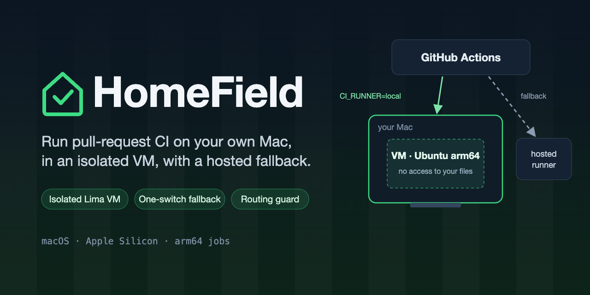

# HomeField

<p align="center">
  
</p>

<p align="center">
  <a href="https://github.com/i2Dev-com/homefield/actions/workflows/ci.yml"></a>
  <a href="LICENSE"></a>
  <a href="#requirements-and-limitations"></a>
  <a href="https://lima-vm.io"></a>
  <a href="https://docs.github.com/en/actions"></a>
</p>

Run selected pull-request jobs from GitHub Actions on a self-hosted runner in
an isolated VM on your Mac, instead of on GitHub-hosted runners. GitHub stays
where CI is triggered, where logs live and where checks report; only the
machine that executes the chosen jobs changes. If the runner is off, you flip
one repository variable and everything runs hosted again.

**The problems it solves:**

- **Minute billing.** Hosted runners bill every job rounded up to a whole
  minute, so repositories with many short pull-request jobs exhaust their
  included minutes on the floors alone; on your Mac those jobs are free.
- **Isolation.** GitHub's own self-hosted runner on a Mac runs jobs as your
  user, with your files, SSH keys and credentials in reach. HomeField runs
  them in a Lima VM with no host data mounts and no reach to the Mac, and
  proves that boundary from inside the guest before anything runs.
- **Opt-in, with a fallback.** A repository joins by merging one routing pull
  request and carries a `runs-on` expression that falls back to
  `ubuntu-latest` whenever the runner is off — pushes, Dependabot and fork
  pull requests stay hosted by default. One variable (`CI_RUNNER`) is the off
  switch, per repository.
- **A guard, not trust.** A GitHub Action fails CI unless every job that can
  reach the runner uses the one reviewed expression, so a widened `runs-on`
  cannot quietly route to your Mac.

It has three parts: **an isolated runner VM** ([`vm/`](vm)), **a one-command
setup** ([`install.sh`](install.sh) → `bin/homefield`), and **a routing
guard** ([`routing-guard`](routing-guard/action.yml)).

## Quick start

**You need:** an Apple Silicon Mac that stays awake while you want routed jobs
to run (a sleeping Mac takes no jobs; they queue, and GitHub fails them after
24 hours), about 5 GiB of memory and a 60 GiB disk for the VM, and **private**
repositories — a public one is refused. An organization's runner group needs
the GitHub Team plan (on Free, use `--group Default` and read
[Requirements](#requirements-and-limitations) first). The full list, including
the `gh` scopes: [getting-started.md](docs/getting-started.md).

On such a Mac, in a terminal, with the URL of your organization (or, for a
personal account or a single repository, `https://github.com/<owner>/<repo>`):

```bash
curl -fsSL https://raw.githubusercontent.com/i2Dev-com/homefield/v0.5.4/install.sh | bash -s -- --url https://github.com/<org>
```

It asks a few questions and does the rest:

Or, once the tap is published, with Homebrew — it verifies the release tarball's
SHA256, so the formula is a trustwin over the one-liner, and `brew upgrade` is
the update path for the host tool (the VM upgrade stays `homefield upgrade`):

```bash
brew tap i2Dev-com/homefield && brew install homefield
```

(The tap is created when the next release is cut: it ships the formula from the
release tarball, and the formula's url, version and sha256 are updated by the
release automation for every release.)

For `install.sh` installs, `homefield update` automates updating the host tool
and every idle VM in one step:

- `homefield update --check` reports whether a newer release is available without
  changing anything.
- `homefield update` applies patch releases automatically after confirming every
  running target VM is idle (failing closed if a job is running or cannot be
  asked), upgrades each VM, and verifies with `homefield diagnose`. Minor/major
  bumps are refused unless `--allow-minor` is passed (they may change the
  routing expression; read [CHANGELOG.md](CHANGELOG.md) first).
- Git checkouts (`git pull`) and Homebrew installs (`brew upgrade homefield` +
  `homefield upgrade`) are refused by `homefield update`.
- On any `upgrade`, `diagnose`, or interruption failure after swapping the host
  tool, `homefield update` restores the previous host tool copy and re-verifies
  with `homefield diagnose` (host-tool rollback does not undo guest-side
  provisioning changes already applied).
- For scheduled checks or opt-in auto-updates, `homefield update --schedule install`
  installs a macOS LaunchAgent (`com.homefield.update`, every
  `HOMEFIELD_UPDATE_INTERVAL` seconds, default `21600` = 6h) running
  `homefield update --auto` (`HOMEFIELD_AUTO_UPDATE` defaults to `off` in the CLI
  and `notify` when installing the schedule; set `HOMEFIELD_AUTO_UPDATE=patch`
  to auto-apply patch bumps while idle, and `HOMEFIELD_AUTO_UPDATE_MINOR=1` to
  also allow minor/major bumps). Busy VMs and un-opted minor bumps skip cleanly
  until the next cycle. Use `--schedule status` / `--schedule remove` to inspect
  or uninstall it.

1. **Homebrew and `gh` login.** Missing Lima or `gh`, or a logged-out `gh`:
   one question each (the `brew` commands it will run; the `gh auth login`
   scopes), then it carries on.
2. **The runner.** `setup` creates the VM, checks its isolation, provisions
   it, creates the `homefield-ci` runner group (organizations), registers the
   runner and waits until GitHub shows it online.
3. **The routing pull request.** It offers to open one for your first
   repository. Nothing is opened on GitHub unless you say yes.
4. **Merge it.** The only step that is yours; its body lists the jobs it
   routes. `setup` waits, then adds the repository to the runner group and
   switches it to the local runner (`CI_RUNNER=local`).

From then on the routed jobs of that repository's pull requests run on your
Mac. The detail behind each step — account types, preflight, tokens,
troubleshooting — is in [getting-started.md](docs/getting-started.md). Try it
first with a one-PR demo workflow: [docs/demo.md](docs/demo.md).

**Later:**

- **Another repository:** `homefield adopt --setup --wait --repo <owner>/<repo>`
  opens its routing pull request, waits for your merge, then switches it on.
- **Another runner** (jobs queue behind each other): `homefield setup
  --instance homefield-2 --url ...` on the same Mac, or the same one-liner on
  another Mac ([runbook: More runners](docs/runbook.md#more-runners)).
- **Leaving:** `homefield route hosted --repo <owner>/<repo>` per repository,
  then `homefield uninstall`.

## How routing works

`runs-on` is evaluated before any step runs, so no action can choose a job's
runner, and a separate "choose the runner" job would itself be billed a full
minute on every run. So each routed job carries the routing expression
inline:

```yaml
runs-on: ${{ vars.CI_RUNNER == 'local' && github.event_name == 'pull_request' && github.actor != 'dependabot[bot]' && !startsWith(github.head_ref, 'dependabot/') && github.event.pull_request.head.repo.full_name == github.repository && fromJSON('["self-hosted","linux","arm64","homefield-ci"]') || 'ubuntu-latest' }}
```

It sends the job to the local runner only when the repository variable
`CI_RUNNER` is `local`, the event is a pull request, the author is not
Dependabot and the branch is not from a fork; otherwise to `ubuntu-latest`.
That is the guarded expression — the default. A repository whose every
contributor you trust with the Mac routes with the simple one instead, the
one-clause expression `homefield adopt --setup` writes without `--guards`:

```yaml
runs-on: ${{ vars.CI_RUNNER == 'local' && 'homefield-ci' || 'ubuntu-latest' }}
```

It has no event, Dependabot or fork clause: every event routes, and the
switch is the only guardrail — also the off button (`homefield route
hosted`). It is for a private repository where being able to open a pull
request already means being trusted with the Mac. The guard accepts either
shape, and a repository may mix them. The routed events, Dependabot and the
hosted fallback image are options of the action, and the expression changes
with them ([routing options](docs/adopting.md#routing-options)).
`routing-guard` keeps every copy identical and every guard in place:

```yaml
      - uses: i2Dev-com/homefield/routing-guard@v0.5.4
        with:
          jobs: |
            ci.yml:lint
            ci.yml:test
```

It also fails on any other `runs-on` that could reach the runner (a bare
`self-hosted`, a label list, a runner group), because GitHub hands a job to
any runner whose labels are a superset of the request, and on workflow syntax
it cannot read ([adopting, step 2](docs/adopting.md#2-route-them)). The
bypasses of this contract found so far — and what each consumer does — are
documented in [the routing guard's contract and past
bypasses](docs/security.md).

## Requirements and limitations

- **Apple Silicon Mac, arm64 jobs.** The VM runs arm64 Linux, with x86-64
  binaries and `linux/amd64` containers translated by Apple's Rosetta:
  `docker run --platform linux/amd64` works as the VM ships, while
  `docker buildx build --platform linux/amd64` needs the `buildx-rosetta`
  preset first ([runbook: Building amd64
  images](docs/runbook.md#building-amd64-images)). Cache keys need
  `runner.arch` ([adopting, step 4](docs/adopting.md#4-fix-cache-keys)).
- **gh ≥ 2.81.** The tool's own GitHub calls use `gh auth status --json hosts`
  (added in gh 2.81.0) and `gh api --jq` (the registration-token fetch);
  `homefield preflight` checks the version and names `brew upgrade gh` when
  the installed gh is older (`preflight` can also pre-fetch the Lima VM image
  into Lima's cache before `install`).
- **Private repositories only.** A pull request runs the workflow files from
  its own branch, so anyone who can open one can change its `runs-on`. See
  [Security model](#security-model).
- **One job at a time per runner**, across every repository using it; others
  queue. For more at once, add runners
  ([runbook: More runners](docs/runbook.md#more-runners));
  [#14](https://github.com/i2Dev-com/homefield/issues/14) tracks several in
  one VM.
- **Only while the Mac is up.** Routed jobs wait while the Mac sleeps or the
  VM is stopped; GitHub fails them after 24 hours. `homefield route hosted`
  is the recovery path
  ([runbook: Switching](docs/runbook.md#switching-per-repository)).
- **Organizations and plans.** A custom runner group needs Team or
  Enterprise; on Free, `--group Default` admits every repository in the
  organization. A personal account has no account-wide runner: each
  repository needs its own registration, and until #14 lands, its own VM
  ([runbook: Runner group](docs/runbook.md#runner-group)).
- **Less software than `ubuntu-latest`.** Add what your jobs need with
  `--preset`, `--packages` or a hook
  ([runbook: Adding tools](docs/runbook.md#adding-tools)).

## Security model

The VM is the boundary. Jobs run pull-request code, so the Mac's files and
credentials are not reachable from inside: no host data mounts, no SSH-agent
forwarding and no host SSH keys, and `bin/homefield` refuses to continue if it
finds any. The one expected mount is Apple's Rosetta runtime
([#21](https://github.com/i2Dev-com/homefield/issues/21)): with Rosetta
enabled, Lima shares the translator read-only into the guest as
`vz-rosetta on /mnt/lima-rosetta` — Apple's two runtime files, nothing of
yours, and writes into it fail. The isolation probe knows that exact line and
still refuses every other host mount.
Inside the guest, jobs are root-equivalent, as on a hosted runner.

**The network is partly isolated.** Jobs can reach the internet and your LAN;
`vm/lima.yaml` asks Lima to stop mapping `host.lima.internal` onto your
loopback. On Lima ≥ 2.3.0 (the minimum,
[#18](https://github.com/i2Dev-com/homefield/issues/18)) nothing bound to the
Mac's loopback is reachable through it, and install and upgrade prove which
state a VM is in from inside the guest. `*`-bound services and the LAN stay
reachable through the Mac's LAN address — don't run anything on the Mac
hosting the runner that the repositories using it shouldn't be able to reach.

By default the routing expression keeps pushes, Dependabot and fork pull
requests on hosted runners; `pull_request_target` cannot be routed. The fork
rule is defence in depth: what keeps strangers off the runner is that only
private repositories can reach it. Registration tokens reach the VM on stdin,
never on a command line. The full table: [runbook: Trust
boundary](docs/runbook.md#trust-boundary); the guard's contract and its past
bypasses: [docs/security.md](docs/security.md); the code-level security
invariant map and independent-audit call: [docs/security-audit.md](docs/security-audit.md).

## Cost

GitHub-hosted runners bill every job rounded up to a whole minute (Linux
x64 $0.006/min, arm64 $0.005/min), after the plan's included minutes (2,000 a
month on Free, 3,000 on Pro and Team). Self-hosted runner usage is free. So
this pays off for repositories that exhaust their included minutes with many
short pull-request jobs, where the per-job minute floor dominates. It does not
help a repository that stays within them, and it costs the Mac's resources
while the VM runs (it holds its configured memory, 5 GiB by default).

GitHub announced a per-minute platform charge for self-hosted runners on
private repositories for March 2026, then postponed it indefinitely. Check
[GitHub's Actions billing](https://docs.github.com/en/billing/concepts/product-billing/github-actions)
for the current terms. See [docs/cost.md](docs/cost.md) for the rate table,
break-even math and `tools/cost.py` savings calculator.

## Alternatives

HomeField sits in a specific gap in the [self-hosted runner landscape](https://github.com/jonico/awesome-runners): turning an existing Apple Silicon Mac into an isolated Linux runner with **zero cloud spend**, **empirically verified VM isolation**, **a workflow-enforced routing guard**, and **automatic fallback to GitHub-hosted runners** whenever the Mac is asleep or offline.

### How HomeField compares

| Capability / Criterion | **HomeField** (`i2Dev-com/homefield`) | **Stock GitHub Runner / Local Mac Apps** (e.g. raw `actions/runner`, [Codemany](https://codemany.com/features/single-use-runners)) | **Bare-Metal / SSH Linux CLIs** (e.g. [Flinner/gh-runnerctl](https://github.com/Flinner/gh-runnerctl)) | **Docker-Container Runners** (e.g. [myoung34](https://github.com/myoung34/docker-github-actions-runner), [zoomies](https://github.com/eyupio/zoomies)) | **macOS VM Runners** ([Tart](https://tart.run) / [Cirrus Runners](https://cirrus-runners.app)) | **Cloud / K8s Autoscalers** ([ARC](https://github.com/actions/actions-runner-controller), [runs-on](https://github.com/runs-on/runs-on), [garm](https://github.com/cloudbase/garm)) |
|---|---|---|---|---|---|---|
| **License & Cost** | **Free, MIT (OSS)**; \$0 on your existing Mac | Free (stock) or paid SaaS (\$20/mo per 2 machines in Codemany) | Free, OSS; \$0 on existing Linux host | Free, OSS; host compute cost | Free CLI (Tart) / paid service (Cirrus) | Free OSS or commercial license + ongoing cloud VM/cluster spend |
| **Mac / Host Isolation Boundary** | **Hardware-virtualized Lima (`vz`) VM**; zero host mounts + host loopback (`127.0.0.1` / `host.lima.internal`) blocked & **empirically probed from inside the guest** | **None on macOS** — jobs run directly as your macOS user with `~/.ssh`, `~/.aws`, files & `localhost` in reach (Codemany's VM mode is Linux KVM only) | User-level Linux process (no root, no VM boundary, no Docker) | Shared container kernel; often requires privileged Docker-in-Docker (`DinD`) | Apple `Virtualization.framework` VM per runner | Dedicated cloud VM or Kubernetes pod |
| **Offline / Sleep Resilience (Hosted Fallback)** | **Built-in automatic fallback** (`vars.CI_RUNNER == 'local' && ... \|\| 'ubuntu-latest'`) + `homefield route hosted` (also re-runs queued jobs) | **None** — jobs queue while the Mac sleeps and fail after 24h | **None** — fixed pool; jobs queue when host is offline | **None** — jobs queue when container/host is down | Requires always-on Mac host or paid cloud pool | Requires always-on cloud control plane (K8s controller / Lambda) |
| **Workflow Routing Guard & Untrusted-PR Protection** | **`routing-guard` Action** fails CI on any unreviewed `runs-on`; keeps fork PRs, `pull_request_target` & Dependabot hosted by default; `adopt` refuses public repos | **None** — any PR branch that can edit `.github/workflows` can target `self-hosted` | **None** built in | **None** built in | **None** built in | Runner-group scoping only; no workflow-level `runs-on` expression guard |
| **Token Hygiene (`PATInRunner`)** | **No PAT in guest** — 1-hour registration token (or GitHub App token in `adopt`) piped via `stdin`, never on `cmdline` or env | Manual token (stock) or single-use JIT config (Codemany) | **No PAT** — short-lived registration token piped over SSH `stdin` | Often **passes a PAT into container env** (`myoung34`, `SanderKnape`); JIT in newer tools (`zoomies`) | GitHub App / JIT token (Cirrus) | GitHub App / short-lived JIT config |
| **Between-Job Cleanup & Ephemeral Mode** | **Per-job cleanup hook + maintenance timer + optional `--ephemeral`** (`homefield re-register --watch`) while keeping Docker/tool caches warm | None (stock) or wiped runner folder + single-use registration (Codemany) | None (persistent user-level runners) | Optional ephemeral container per job | Ephemeral VM snapshot cloned per job | Ephemeral pod or fresh cloud VM destroyed after every job |
| **Apple Silicon `arm64` + `x86-64` (`amd64`) Support** | **Native `linux/arm64` + Apple Rosetta** for `x86-64` binaries & `linux/amd64` containers (`buildx-rosetta` preset avoids QEMU crashes) | Native host OS/arch | Native Linux `x64` / `arm64` | Native arch (or slower QEMU emulation) | Native macOS & Linux `arm64` VMs | Native `x64` and `arm64` cloud instances |
| **Onboarding, Fleet Ops, Auto-Update & Cost Visibility** | **1-command `setup`**, `adopt --setup` PR generator, `homefield fleet` (multi-VM), `homefield update --schedule` (idle-gated with rollback), `report` & `tools/cost.py` | Manual CLI (stock) or GUI app (Codemany) | Declarative TOML + `converge` CLI | Manual `docker run` / Compose / Helm | CLI / GitHub App | Terraform / CloudFormation / Helm + cloud IAM |
| **Webhook-Driven Elastic Autoscaling (`0 → N`)** *(where others do more)* | **No** — fixed Lima VM(s) per Mac (`--instance` + `homefield fleet`), falling back to GitHub-hosted runners when off | **Yes** in Codemany (registers a single-use runner per job) | **No** (fixed pools by design) | **Yes** in `zoomies`; **No** in static Docker wrappers | **Yes** in Cirrus Runners | **Yes** — scales `0 → N` cloud VMs/pods from `workflow_job` webhooks |
| **Full Root-Disk Reset (Fresh VM Image per Job)** *(where others do more)* | **No** — keeps the Lima VM warm for fast Docker/apt caches; cleans workspace/containers per job + optional `--ephemeral` registration | **No** on macOS (Codemany optional KVM VM per job on Linux only) | **No** | Container recreated (when ephemeral), shared host kernel | **Yes** — clones a fresh VM snapshot per job | **Yes** (VM autoscalers terminate the instance after one job) |
| **Native macOS / Xcode / iOS & Windows Jobs** *(where others do more)* | **No** — runs an **Ubuntu 24.04 Linux** guest on Apple Silicon | **Yes** (runs directly on macOS host) | **No** (Linux only) | Linux / Windows containers | **Yes** — native macOS/Xcode VMs on Apple Silicon | **Yes** — Linux, Windows, and EC2 macOS dedicated hosts |
| **Direct Linux Host Installer (without macOS / Lima)** *(roadmap)* | **Not yet** — macOS + Lima CLI today (`vm/provision.sh` runs on Ubuntu `arm64`; direct Linux-host installer tracked in [#231](https://github.com/i2Dev-com/homefield/issues/231)) | **Yes** (Linux & macOS) | **Yes** (built for Linux / SSH hosts) | **Yes** (any Docker host) | **No** (Apple Silicon macOS only) | **Yes** (cloud / K8s Linux nodes) |
| **Concurrent Jobs per VM & GHES** *(roadmap)* | **1 job per VM** today (add VMs via `--instance` + `homefield fleet`; multi-runner per VM tracked in [#14](https://github.com/i2Dev-com/homefield/issues/14)); **`github.com` only** (no GHES) | Multiple runners per machine; `github.com` only (Codemany) | Multiple runners per host | Multiple containers per host; GHES supported in most | Multiple VMs per Mac | High cluster concurrency; GHES supported |

*(For local workflow iteration without pushing to GitHub at all, see **[act](https://github.com/nektos/act)** — useful for testing workflow changes locally, though it does not report pull-request check statuses.)*

## Documentation

| Document | What it covers |
|---|---|
| [docs/getting-started.md](docs/getting-started.md) | The first install in detail: the one-liner, `setup`, account types, preflight, tokens, troubleshooting |
| [docs/demo.md](docs/demo.md) | Try HomeField in 5 minutes: one-PR demo workflow to prove the runner and guard before routing real CI |
| [docs/adopting.md](docs/adopting.md) | Routing a repository: the seven steps, the guard, `adopt` and its pull request |
| [docs/runbook.md](docs/runbook.md) | Operating it: setup, runner group, switching, failure modes, maintenance, moving, removal |
| [docs/security.md](docs/security.md) | The routing guard's contract, and the bypasses found and fixed so far |
| [docs/security-audit.md](docs/security-audit.md) | Code-level invariant map, GitHub hardening alignment, and researcher audit invitation |
| [docs/tap.md](docs/tap.md) | The Homebrew tap: the formula template, the release automation and the `TAP_TOKEN` secret |
| [docs/cli.md](docs/cli.md) | Every command, option, exit code and environment variable — for scripts and AI agents |
| [docs/cost.md](docs/cost.md) | Hosted runner rates, break-even math and the `tools/cost.py` savings calculator |
| [CHANGELOG.md](CHANGELOG.md) | What each release changed, and how to upgrade |

## For AI agents

This is a CLI-driven tool, and its docs are written to be driven without a
human in the loop:

- `homefield --help` is the one-line-per-command overview; `homefield help
  <command>` (or `<command> --help`) prints one command's options; `homefield
  help` is the full reference. [docs/cli.md](docs/cli.md) is the
  machine-oriented reference: commands, options, exit codes, the
  non-interactive environment variables (`HOMEFIELD_YES=1` answers prompts;
  `HOMEFIELD_INSTANCE` names a VM; `HOMEFIELD_GH_TIMEOUT` bounds GitHub
  calls) and the `--json` output shapes.
- `homefield diagnose --json` is the one read-only health check to run first;
  it exits 0 when every VM is healthy and names the fixing command for each
  problem it finds.

## Versioning

Releases are exact semver tags (`v0.1.0`, `v0.2.1`, `v0.3.0`), and a tag is
never moved (backed by the `refs/tags/v*` ruleset in
[`.github/rulesets/protect-release-tags.json`](.github/rulesets/protect-release-tags.json),
which blocks tag deletion, updates, and non-fast-forward moves). Pin an exact
tag, such as `routing-guard@v0.3.0`, or a full 40-character commit SHA
(`uses: i2Dev-com/homefield/routing-guard@<40-char-sha> # v0.5.4`) — a commit
SHA binds your workflow cryptographically to one tree without depending on
upstream tag rules, and Dependabot's `github-actions` ecosystem updates either
form for you. There is no floating major tag to follow.

While the version is 0.x, a change that makes a previously passing workflow
fail, such as a new guard in the expression, bumps the minor version
(0.1 to 0.2), because every consumer has to update its inline copies at the
same time. Compatible changes bump the patch. [`CHANGELOG.md`](CHANGELOG.md)
says how to upgrade. Merged changes wait on `main`, listed under *Unreleased*
in the changelog, until a release is cut, so the docs on `main` can run ahead
of the latest tag.

## Contributing, security, license

Contributions are welcome: the checks to run before a pull request (the test
suites, `shellcheck`, `actionlint`) are listed in
[`CONTRIBUTING.md`](CONTRIBUTING.md). Report security issues privately, as
described in [`SECURITY.md`](SECURITY.md), which also lists the known
limitations. Licensed under the [MIT License](LICENSE).