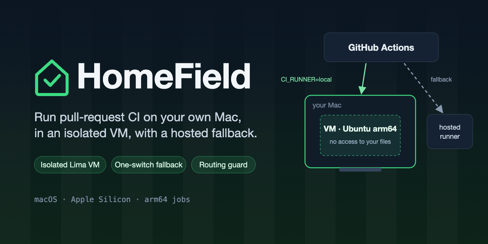

# HomeField

<p align="center">
  
</p>

<p align="center">
  <a href="https://github.com/i2Dev-com/homefield/actions/workflows/ci.yml"></a>
  <a href="LICENSE"></a>
  <a href="#requirements-and-limitations"></a>
  <a href="https://lima-vm.io"></a>
  <a href="https://docs.github.com/en/actions"></a>
</p>

Run selected pull-request jobs from GitHub Actions on a self-hosted runner in
an isolated VM on your Mac, instead of on GitHub-hosted runners. GitHub stays
where CI is triggered, where logs live and where checks report; only the
machine that executes the chosen jobs changes. If the runner is off, you flip
one repository variable and everything runs hosted again.

It has three parts:

- **An isolated runner VM** ([`vm/`](vm)): Ubuntu 24.04 arm64 in
  [Lima](https://lima-vm.io), with no access to the Mac's files, SSH keys or
  credentials. It does have network access, including to the Mac's own
  services ([Security model](#security-model)).
- **A one-command setup** ([`install.sh`](install.sh), then
  [`bin/homefield`](bin/homefield)): install, upgrade, status, uninstall.
- **A routing guard** ([`routing-guard`](routing-guard/action.yml)): a
  GitHub Action that fails CI unless every job that can reach the runner uses
  the one reviewed `runs-on` expression, with its safety guards, and the set of
  routed jobs is the reviewed list.

## Quick start

On an Apple Silicon Mac, in a terminal:

```bash
curl -fsSL https://raw.githubusercontent.com/i2Dev-com/homefield/v0.3.1/install.sh | bash
```

This installs [Lima](https://lima-vm.io) with Homebrew if it is missing or older
than 2.0 (it asks first), puts the tool in `~/.local/share/homefield` with a
`homefield` command on your PATH, and runs `homefield install`. That asks for
your organization or repository URL, creates the VM, checks its isolation,
provisions it, creates the `homefield-ci` runner group for an organization
(selected repositories only, no public ones), registers the runner with the
routing label `homefield-ci` and waits until GitHub shows it online. To give
the URL up front, or any other option, append it:

```bash
... | bash -s -- --url https://github.com/<org>      # or https://github.com/<owner>/<repo>
```

From a checkout, with Lima ≥ 2.0, run `bin/homefield install --url
https://github.com/<org>` instead. Running the one-liner again upgrades the
tool and leaves an existing VM alone; `homefield upgrade` updates the VM,
`homefield version` says when a newer release exists, and `homefield status`
shows the runner and whether GitHub still lists it.

Before a checkout install, `homefield preflight` reports on everything the tool
needs: macOS, Apple Silicon, Lima ≥ 2.0, gh (logged in; the `admin:org` scope is
only a warning, since a repository URL does not need it), python3 and Homebrew.
It exits 0 when every check passes and 1 otherwise, naming the command that
fixes each failure (`brew install lima`, `gh auth login`, and so on); `install`
prints it first and then gates on its own subset — macOS, Apple Silicon and
Lima — before creating anything, so gh, python3 or Homebrew missing stops
`preflight` but not `install`. The one-liner checks only macOS, Apple Silicon and
Lima, and needs Homebrew to install Lima.

Registration needs a one-hour token, and the group needs the `admin:org`
scope. `gh` fetches the token if you are an org owner or a repository admin
(and offers to add the scope); otherwise you paste a token from the runners
page's *New runner*. A repository URL needs neither a group nor the scope.
The group admits no repository until `adopt` adds it.

Then route jobs from a repository by following
[`docs/adopting.md`](docs/adopting.md), and once that is merged:

```bash
homefield adopt --repo <owner>/<repo>    # hosted again: homefield route hosted --repo <owner>/<repo>
```

`adopt` checks that the repository's routing and guard are in place, and only
then adds it to the runner group and switches it to the local runner. It
refuses a public repository. `--dry-run` shows what it would do.

`homefield help` lists the options (`--label`, `--packages`, `--cpus`,
...). [`docs/runbook.md`](docs/runbook.md) covers operating it.

## Requirements and limitations

- **Apple Silicon Mac, arm64 jobs.** The VM uses Apple's
  Virtualization.framework and runs arm64 Linux. Jobs that need x86-64 (amd64
  container images, prebuilt x86 binaries, x86 Docker builds) belong on hosted
  runners. Cache keys need `runner.arch` ([adopting, step 4](docs/adopting.md#4-fix-cache-keys)).
  `provision.sh` also runs on an Ubuntu arm64 host
  ([runbook](docs/runbook.md#moving-to-dedicated-hardware)).
- **Private repositories only.** A pull request runs the workflow files from
  its own branch, so anyone who can open one can change its `runs-on`. Keep
  every repository that can reach the runner private, with the runner group
  refusing public ones. See [Security model](#security-model).
- **One job at a time per runner**, across every repository using it. Others
  queue. For more at once, add runners: another VM on the same Mac or another
  Mac, each with its own memory ([runbook: More runners](docs/runbook.md#more-runners)).
  Several runners in one VM is tracked in [#14](https://github.com/i2Dev-com/homefield/issues/14).
- **Only while the Mac is up.** Routed jobs wait while the Mac sleeps or the
  VM is stopped, and GitHub fails them after 24 hours. Pushes run hosted by
  default, so merging and deploying never wait on the Mac
  ([routing options](docs/adopting.md#routing-options)).
  `bin/homefield route hosted --repo <owner>/<repo>` switches a repository to
  hosted and re-runs whatever was waiting
  ([runbook: Switching](docs/runbook.md#switching-per-repository)).
- **Organizations and plans.** A custom runner group, which limits which
  repositories can use the runner, needs the GitHub Team plan or Enterprise. On
  the Free plan there is only the Default group, which every repository in the
  organization can use: register there only if you trust all of them, with
  `--group Default`. A **personal account** hits two separate limits.
  GitHub's: runners register at repository, organization or enterprise scope
  and jobs never cross scopes, so a personal account has no account-wide
  runner — a runner registered to an organization can never serve a personal
  repository, and each personal repository needs its own repository-scoped
  registration (`--url https://github.com/<you>/<repo>`). And ours: one VM
  runs one runner, so until
  [#14](https://github.com/i2Dev-com/homefield/issues/14) lands, each of
  those registrations is its own VM
  ([runbook: Runner group](docs/runbook.md#runner-group)).
- **Less software than `ubuntu-latest`.** The VM starts small. Add what your
  jobs need with `--packages` or a hook
  ([runbook: Adding tools](docs/runbook.md#adding-tools)).

## Security model

The VM is the boundary. Jobs run pull-request code, so the Mac's files and
credentials are not reachable from inside: no mounts (`mounts: []` plus
`--mount-none`, and `bin/homefield` refuses to continue if it finds any), no
SSH-agent forwarding and no host SSH keys. Services started by a job are not
forwarded to the Mac's `localhost`. Inside the guest, jobs are
root-equivalent (the `docker` group), which is why the VM and not a user
account is the boundary.

**The network is partly isolated.** Jobs can reach the internet and your
LAN. `vm/lima.yaml` asks Lima to stop mapping `host.lima.internal` onto
your loopback (`networkOpts.hostLoopback: false`): on VMs created with
Lima ≥ 2.3.0 (not yet a stable release —
[#18](https://github.com/i2Dev-com/homefield/issues/18)) that gateway
answers for itself, and nothing bound to the Mac's loopback is reachable
through it — not the `127.0.0.1`-only services (local databases, development
servers, local AI or tool APIs) and not `*`-bound ones either; `*`-bound
services stay reachable through the Mac's LAN address. Lima 2.0–2.2 ignore
the ask, and on them everything the Mac listens on is still reachable.
Install and upgrade prove which state a VM is in from inside the guest
rather than trusting the config. Until Lima 2.3.0 is stable, don't run
anything on the Mac hosting the runner that the repositories using it
shouldn't be able to reach.

By default the routing expression keeps pushes, Dependabot and pull requests
from forks on hosted runners; fork pull requests stay hosted whatever the
options. Routing Dependabot puts unreviewed install scripts on a VM that is
not thrown away after the job, and routing push, schedule or dispatch jobs
makes them depend on the Mac being awake
([routing options](docs/adopting.md#routing-options)).
`pull_request_target` cannot be routed. The fork rule is defence in depth
only: what keeps strangers off the runner is that only private repositories
can reach it. Repositories that share the runner share one VM, one job after
another, and can see what earlier jobs left behind, so share it only between
repositories you would trust with each other's pull requests. Registration
tokens reach the VM on stdin, never on a command line. The full table:
[runbook: Trust boundary](docs/runbook.md#trust-boundary).

## How routing works

`runs-on` is evaluated before any step runs, so no action can choose a job's
runner, and a separate "choose the runner" job would itself be billed a full
minute on every run. So each routed job carries the routing expression
inline:

```yaml
runs-on: ${{ vars.CI_RUNNER == 'local' && github.event_name == 'pull_request' && github.actor != 'dependabot[bot]' && !startsWith(github.head_ref, 'dependabot/') && github.event.pull_request.head.repo.full_name == github.repository && fromJSON('["self-hosted","linux","arm64","homefield-ci"]') || 'ubuntu-latest' }}
```

It sends the job to the local runner only when the repository variable
`CI_RUNNER` is `local`, the event is a pull request, the author is not
Dependabot and the branch is not from a fork; otherwise to `ubuntu-latest`.
That is the default. The routed events, Dependabot and the hosted fallback
image are options of the action, and the expression changes with them
([routing options](docs/adopting.md#routing-options)).
`routing-guard` keeps every copy identical and every guard in place:

```yaml
      - uses: i2Dev-com/homefield/routing-guard@v0.3.1
        with:
          jobs: |
            ci.yml:lint
            ci.yml:test
```

It also fails on any other `runs-on` that could reach the runner (a bare
`self-hosted`, a label list, a runner group), because GitHub hands a job to
any runner whose labels are a superset of the request, and on workflow syntax
it cannot read ([adopting, step 2](docs/adopting.md#2-route-them)).

## Cost

GitHub-hosted runners bill every job rounded up to a whole minute (Linux
x64 $0.006/min, arm64 $0.005/min), after the plan's included minutes (2,000 a
month on Free, 3,000 on Pro and Team). Self-hosted runner usage is free. So
this pays off for repositories that exhaust their included minutes with many
short pull-request jobs, where the per-job minute floor dominates. It does not
help a repository that stays within them, and it costs the Mac's resources
while the VM runs (it holds its configured memory, 5 GiB by default).

GitHub announced a per-minute platform charge for self-hosted runners on
private repositories for March 2026, then postponed it indefinitely. Check
[GitHub's Actions billing](https://docs.github.com/en/billing/concepts/product-billing/github-actions)
for the current terms.

## Alternatives

- **[GitHub's own self-hosted runner](https://docs.github.com/en/actions/how-tos/manage-runners/self-hosted-runners/add-runners)
  on the Mac**: a few commands (`config.sh`, then `run.sh` or `svc.sh`), but
  jobs run as your macOS user with your files, SSH keys and credentials in
  reach, routed jobs wait while the runner is offline, and nothing keeps fork
  pull requests, Dependabot or a widened `runs-on` off it. Enough for one
  private repository whose every contributor you trust with your Mac.
- **[actions-runner-controller](https://github.com/actions/actions-runner-controller)**:
  ephemeral runners on Kubernetes. The right choice for a team with a
  cluster; far more to operate than one VM.
- **[Tart](https://tart.run) / [Cirrus Runners](https://cirrus-runners.app)**:
  macOS and Linux VMs on Apple Silicon, including macOS jobs, which this does
  not do.
- **[act](https://github.com/nektos/act)**: runs workflows locally without
  GitHub. Good for iterating on a workflow, but no checks on the pull request.
- **Larger or cheaper hosted runners**: no hardware to run, and nothing to
  secure.

This project's niche: an opt-in, per-repository switch with a hosted
fallback, guard rails that keep the routing reviewed, and a VM that keeps
pull-request code away from the Mac it runs on.

## Repository layout

| Path | What it is |
|---|---|
| [`install.sh`](install.sh) | The one-line installer: downloads the tool, puts `homefield` on the PATH, installs Lima, runs `homefield install` |
| [`bin/homefield`](bin/homefield) | Install, upgrade, inspect and remove the runner on this Mac; adopt and switch repositories |
| [`vm/lima.yaml`](vm/lima.yaml) | The VM: Ubuntu 24.04 arm64, no host mounts, no forwarding of guest ports to the Mac, no SSH-agent forwarding |
| [`vm/provision.sh`](vm/provision.sh) | Runs inside the VM: packages, Docker, the checksum-pinned runner, maintenance timers, registration (settings at the top of the file); `ensure-service` restores the runner's service on its own |
| [`routing-guard/`](routing-guard/action.yml) | The routing guard action |
| [`tools/`](tools) | Python helpers behind `homefield report` and `homefield adopt` |
| [`docs/adopting.md`](docs/adopting.md) | Checklist for routing a repository's jobs to the runner |
| [`docs/runbook.md`](docs/runbook.md) | Operating it: setup, runner group, switching, failure modes, maintenance, moving, removal |
| [`docs/assets/`](docs/assets) | The banner image and its SVG source |

## Development

The checks to run before a pull request (the test suites, `shellcheck`,
`actionlint`) are listed in [`CONTRIBUTING.md`](CONTRIBUTING.md).

## Versioning

Releases are exact semver tags (`v0.1.0`, `v0.2.1`, `v0.3.0`), and a tag is
never moved. Pin an exact tag, such as `routing-guard@v0.3.0` (Dependabot's
`github-actions` ecosystem can bump it for you), or a full commit SHA. There
is no floating major tag to follow.

While the version is 0.x, a change that makes a previously passing workflow
fail, such as a new guard in the expression, bumps the minor version
(0.1 to 0.2), because every consumer has to update its inline copies at the
same time. Compatible changes bump the patch. [`CHANGELOG.md`](CHANGELOG.md)
says how to upgrade. Merged changes wait on `main`, listed under *Unreleased*
in the changelog, until a release is cut, so the docs on `main` can run ahead
of the latest tag.

## Contributing, security, license

Contributions are welcome: see [`CONTRIBUTING.md`](CONTRIBUTING.md). Report
security issues privately, as described in [`SECURITY.md`](SECURITY.md), which
also lists the known limitations. Licensed under the [MIT License](LICENSE).
