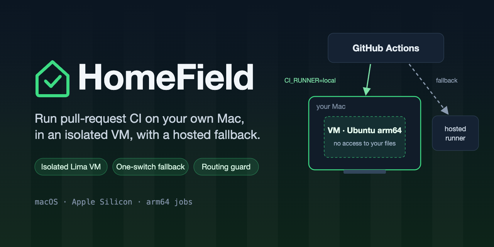

# HomeField

<p align="center">
  
</p>

<p align="center">
  <a href="https://github.com/i2Dev-com/homefield/actions/workflows/ci.yml"></a>
  <a href="LICENSE"></a>
  <a href="#requirements-and-limitations"></a>
  <a href="https://lima-vm.io"></a>
  <a href="https://docs.github.com/en/actions"></a>
</p>

Run selected pull-request jobs from GitHub Actions on a self-hosted runner in
an isolated VM on your Mac, instead of on GitHub-hosted runners. GitHub stays
where CI is triggered, where logs live and where checks report; only the
machine that executes the chosen jobs changes. If the runner is off, you flip
one repository variable and everything runs hosted again.

It has three parts:

- **An isolated runner VM** ([`vm/`](vm)): Ubuntu 24.04 arm64 in
  [Lima](https://lima-vm.io), with no access to the Mac's files, SSH keys or
  credentials. It does have network access, including to the Mac's own
  services ([Security model](#security-model)).
- **A one-command setup** ([`install.sh`](install.sh), then
  [`bin/homefield`](bin/homefield)): setup, install, upgrade, status, diagnose, uninstall, reset.
- **A routing guard** ([`routing-guard`](routing-guard/action.yml)): a
  GitHub Action that fails CI unless every job that can reach the runner uses
  the one reviewed `runs-on` expression, with its safety guards, and the set of
  routed jobs is the reviewed list.

## Quick start

**You need:**

- An Apple Silicon Mac that stays awake while you want routed jobs to run.
  A sleeping Mac (or one with its lid closed) takes no jobs; they queue, and
  GitHub fails them after 24 hours. In System Settings (Battery or Energy,
  Options) turn on the option that prevents automatic sleeping when the display
  is off, or run `caffeinate -s` in a terminal for a while (it holds only on
  power). `setup` turns on Lima's autostart so the VM comes back after a reboot
  ([runbook: Setup](docs/runbook.md#setup-once-per-machine)).
- About 5 GiB of memory for the VM while it runs, and a 60 GiB virtual disk
  (6 CPUs, all set in [`vm/lima.yaml`](vm/lima.yaml); `--cpus` and `--memory`
  change the first two when the VM is created).
- **Private** repositories. A public one is refused.
- For an organization, an owner's `gh` login (it asks for the `admin:org`
  scope), or a registration token you paste. A repository URL needs neither.
- For an organization on the **Free** plan, `--group Default` at the end of the
  command below: custom runner groups need Team or Enterprise, and `setup`
  stops at the group step without it. Read
  [Organizations and plans](#requirements-and-limitations) first, because that
  group admits every repository in the organization.

On such a Mac, in a terminal, with the URL of your organization (or, for a
personal account or a single repository, `https://github.com/<owner>/<repo>`):

```bash
curl -fsSL https://raw.githubusercontent.com/i2Dev-com/homefield/v0.3.1/install.sh | bash -s -- --url https://github.com/<org>
```

It asks a few questions and does the rest:

1. **Homebrew.** If Lima or `gh` is missing, one question names the `brew`
   commands it will run. Answer yes.
2. **`gh` login.** If `gh` is not logged in, `setup` offers `gh auth login`.
   For an organization, giving `--url` up front means the login also asks for
   the `admin:org` scope the runner group needs, so you authorize once in the
   browser, not twice.
3. **The runner.** `setup` creates the VM, checks its isolation, provisions it,
   creates the `homefield-ci` runner group (organizations), registers the
   runner and waits until GitHub shows it online.
4. **The routing pull request.** It asks `Open the routing pull request for
   <owner>/<repo> now, and carry on once you merge it? [Y/n]` (for an
   organization, which repository to route first). Nothing is opened on GitHub
   unless you say yes.
5. **Merge it.** That is the only step that is yours; its body lists the jobs
   it routes. `setup` waits, then adds the repository to the runner group and
   switches it to the local runner (`CI_RUNNER=local`). A terminal is then
   asked once whether to re-run the latest pull-request run to confirm where
   each job landed (default no: it uses CI minutes).

From then on the routed jobs of that repository's pull requests run on your
Mac. `homefield route hosted --repo <owner>/<repo>` switches it back. The rest
of this section is detail: account types, preflight and what to do when
something stops.

### Later: another repository, another runner, leaving

- **Another repository.** One command, from any terminal with `gh`:

  ```bash
  homefield adopt --setup --wait --repo <owner>/<repo>
  ```

  It opens the routing pull request, waits for you to merge it, then adds the
  repository to the runner group and switches it to the local runner, as in
  step 5 above. Without `--wait`, run `homefield adopt --repo <owner>/<repo>`
  after the merge. If the repository has no pull-request job on a GitHub-hosted
  image it stops with "nothing to route". To keep some jobs hosted, see
  [`docs/adopting.md`](docs/adopting.md#1-choose-the-jobs).
- **Another runner**, when jobs wait for each other: `homefield setup
  --instance homefield-2 --url https://github.com/<org>` on the same Mac, or
  the same one-liner on another Mac. Repositories and routing do not change,
  so at the end answer **n** (or press Enter at the organization's question) to
  the offer to open a routing pull request. Use the same `--label`, `--group`
  and `--packages` as the first runner
  ([runbook: More runners](docs/runbook.md#more-runners)).
- **Leaving.** Switch each repository back with `homefield route hosted --repo
  <owner>/<repo>`, then `homefield uninstall` removes the runner's registration
  and the VM ([runbook: Removing the runner](docs/runbook.md#removing-the-runner)).

### Details and options

#### The one-liner and `setup`

The one-liner installs Lima and `gh` with Homebrew if they are missing (Lima
also if it is older than 2.0), after one question that names the `brew`
commands it will run, puts the tool in `~/.local/share/homefield` with a
`homefield` command on your PATH, and runs `homefield setup` (`homefield
install` on a release older than `setup`). If `gh` is installed but not logged
in, and that is the only thing missing, `setup` offers to run `gh auth login`
for you on a terminal (with `-s admin:org` when `--url` is an organization, so
the runner group needs no second authorization). Without `--url`, `setup` asks
for your organization or repository URL. It creates the VM, checks its
isolation, provisions it, creates the `homefield-ci` runner group for an
organization (selected repositories only, no public ones), registers the
runner with the routing label `homefield-ci` and waits until GitHub shows it
online. Any other option is appended after `bash -s --`, like `--url`:

```bash
... | bash -s -- --url https://github.com/<org>      # or https://github.com/<owner>/<repo>
```

From a checkout, with Lima ≥ 2.0, run `bin/homefield setup --url
https://github.com/<org>` instead. `setup` is the whole first-time setup in one
command: it runs `preflight` first and stops, with nothing created, if any check
fails (a warning does not stop it; on a terminal, a `gh` that is not logged in
is first offered `gh auth login` when no other check fails, and the check runs
after it); then it does what `install` does, and ends with a summary, one line
per step, that marks what is done with a check mark and what needs attention
with `!` (a runner group wider than recommended, a runner that is not online
yet), followed by the next steps and the repositories that can already use the
runner.

On a terminal it then offers to open the routing pull request and carry on once
you merge it (`homefield adopt --setup --wait`): for the repository the runner
is registered to (a personal account, or a repository URL) it asks `Open the
routing pull request for <owner>/<repo> now, and carry on once you merge it?
[Y/n]`, and for an organization it asks which repository to route first (a
name, or `owner/repo`; Enter skips). Nothing is opened on GitHub unless you say
yes. After yes, `setup` waits for your merge and then adds the repository to the
runner group and switches it on, in the same run (Ctrl-C is safe: it leaves the
pull request as it is and prints the command to go on with). If `adopt` refuses
(a public repository, no write access, no workflow to route) the setup is still
done: it says so and how to run `adopt` again; so it is if the wait ends without
a merge, and then it says the pull request is open. Without a terminal, `setup`
only prints the next steps. It takes `install`'s options, and on an instance
that is already registered it upgrades it, as `install` does (without the
offer).

`install` stays the lower-level command: it prints the preflight report but
does not stop on it, and ends with its own short advice. Running the one-liner
again upgrades the tool and leaves an existing VM alone; `homefield upgrade`
updates the VM, `homefield version` says when a newer release exists, and
`homefield status` shows the runner and whether GitHub still lists it.

#### Personal account or organization

`install` looks the URL's owner up first (with `gh`, else the public API) and
says whether it found an organization or a personal account. A personal
account cannot have an account-wide runner or a runner group, so it is
registered for one repository (`--url https://github.com/<you>/<repo>`); given
only its owner URL, `install` asks for the repository on a terminal and stops
without one. If the lookup cannot run (the API is unreachable, or your token
cannot see the account), `--personal` or `--org` says which it is and skips the
lookup; they cannot be combined.

#### Preflight

Before a checkout setup, `homefield preflight` reports on everything the tool
needs: macOS, Apple Silicon, Lima ≥ 2.0, gh (logged in; the `admin:org` scope is
only a warning, since a repository URL does not need it), python3 and Homebrew.
It exits 0 when every check passes and 1 otherwise, naming the command that
fixes each failure (`brew install lima`, `gh auth login`, and so on); `setup`
prints it first and stops on any failure, while `install` prints it and then
gates on its own subset (macOS, Apple Silicon and Lima) before creating
anything, so gh, python3 or Homebrew missing stops `preflight` and `setup` but
not `install`. The one-liner itself checks only macOS, Apple Silicon and
Lima, and needs Homebrew to install Lima, which it checks before downloading
anything. It offers `brew install gh` in the same question but does not need
it: declining, having no terminal (without `HOMEFIELD_YES=1`) or having no
Homebrew goes on, and the preflight it then hands over to (`setup`) reports a
missing `gh` with the command to run, so a failed preflight check stops it
before the VM is created. `HOMEFIELD_YES=1` installs both without asking.

#### When something goes wrong

`homefield diagnose` (`--json` for scripts) reads everything in one report: the
VM, the runner and whether GitHub lists it, the runner group, and the
prerequisites. It names each problem with its fix command, exits 1 on any
problem, and only reads: it never starts, stops or changes anything.
When an install stops partway, `homefield reset` rolls back whatever it left
(the runner's registration, the VM and the runner group install created),
after listing it and asking; it is a no-op when there is nothing to undo
([runbook](docs/runbook.md#rolling-back-a-failed-install)).

#### Registration token and runner group

Registration needs a one-hour token, and the group needs the `admin:org`
scope. `gh` fetches the token if you are an org owner or a repository admin
(and offers to add the scope); otherwise you paste a token from the runners
page's *New runner*. A repository URL needs neither a group nor the scope.
The group admits no repository until `adopt` adds it.

#### Routing a repository yourself

`setup` offers to route a repository at its end. To do it later, or for
another repository, follow [`docs/adopting.md`](docs/adopting.md), and once
that is merged:

```bash
homefield adopt --repo <owner>/<repo>    # hosted again: homefield route hosted --repo <owner>/<repo>
```

`adopt` checks that the repository's routing and guard are in place, and only
then adds it to the runner group and switches it to the local runner. It
refuses a public repository. `--dry-run` shows what it would do. After the
switch it offers to re-run the repository's latest pull-request run and report
where each job landed (`--verify` does it without asking, `--no-verify` never;
[`docs/adopting.md`](docs/adopting.md#let-adopt-check-the-first-run)).

Rather than editing the workflows by hand, `homefield adopt --setup --repo
<owner>/<repo>` opens a pull request that writes those edits for you: the
routing expression on every pull-request job that runs on a GitHub-hosted
image, the guard step listing them, and `runner.arch` added to the cache keys
([`docs/adopting.md`](docs/adopting.md#let-adopt-write-steps-1-to-4)). Merge
it, then run `homefield adopt` to switch the repository on, or add `--wait`
(`homefield adopt --setup --wait --repo <owner>/<repo>`) and the same command
waits for your merge, then carries on and switches the repository on. A fresh
`setup` on a terminal offers to do exactly that for you at its end.

`homefield help` lists the options (`--label`, `--packages`, `--cpus`,
...). [`docs/runbook.md`](docs/runbook.md) covers operating it.

## Requirements and limitations

- **Apple Silicon Mac, arm64 jobs.** The VM uses Apple's
  Virtualization.framework and runs arm64 Linux. Jobs that need x86-64 (amd64
  container images, prebuilt x86 binaries, x86 Docker builds) belong on hosted
  runners. Cache keys need `runner.arch` ([adopting, step 4](docs/adopting.md#4-fix-cache-keys)).
  `provision.sh` also runs on an Ubuntu arm64 host
  ([runbook](docs/runbook.md#moving-to-dedicated-hardware)).
- **Private repositories only.** A pull request runs the workflow files from
  its own branch, so anyone who can open one can change its `runs-on`. Keep
  every repository that can reach the runner private, with the runner group
  refusing public ones. See [Security model](#security-model).
- **One job at a time per runner**, across every repository using it. Others
  queue. For more at once, add runners: another VM on the same Mac or another
  Mac, each with its own memory ([runbook: More runners](docs/runbook.md#more-runners)).
  Several runners in one VM is tracked in [#14](https://github.com/i2Dev-com/homefield/issues/14).
- **Only while the Mac is up.** Routed jobs wait while the Mac sleeps or the
  VM is stopped, and GitHub fails them after 24 hours. Pushes run hosted by
  default, so merging and deploying never wait on the Mac
  ([routing options](docs/adopting.md#routing-options)).
  `bin/homefield route hosted --repo <owner>/<repo>` switches a repository to
  hosted and re-runs whatever was waiting
  ([runbook: Switching](docs/runbook.md#switching-per-repository)).
- **Organizations and plans.** A custom runner group, which limits which
  repositories can use the runner, needs the GitHub Team plan or Enterprise. On
  the Free plan there is only the Default group, which every repository in the
  organization can use: register there only if you trust all of them, with
  `--group Default`. A **personal account** hits two separate limits.
  GitHub's: runners register at repository, organization or enterprise scope
  and jobs never cross scopes, so a personal account has no account-wide
  runner — a runner registered to an organization can never serve a personal
  repository, and each personal repository needs its own repository-scoped
  registration (`--url https://github.com/<you>/<repo>`; `install` detects a
  personal account, or `--personal` says so). And ours: one VM
  runs one runner, so until
  [#14](https://github.com/i2Dev-com/homefield/issues/14) lands, each of
  those registrations is its own VM
  ([runbook: Runner group](docs/runbook.md#runner-group)).
- **Less software than `ubuntu-latest`.** The VM starts small. Add what your
  jobs need with `--packages` or a hook
  ([runbook: Adding tools](docs/runbook.md#adding-tools)).

## Security model

The VM is the boundary. Jobs run pull-request code, so the Mac's files and
credentials are not reachable from inside: no mounts (`mounts: []` plus
`--mount-none`, and `bin/homefield` refuses to continue if it finds any), no
SSH-agent forwarding and no host SSH keys. Services started by a job are not
forwarded to the Mac's `localhost`. Inside the guest, jobs are
root-equivalent (the `docker` group), which is why the VM and not a user
account is the boundary.

**The network is partly isolated.** Jobs can reach the internet and your
LAN. `vm/lima.yaml` asks Lima to stop mapping `host.lima.internal` onto
your loopback (`networkOpts.hostLoopback: false`): on VMs created with
Lima ≥ 2.3.0 (not yet a stable release —
[#18](https://github.com/i2Dev-com/homefield/issues/18)) that gateway
answers for itself, and nothing bound to the Mac's loopback is reachable
through it — not the `127.0.0.1`-only services (local databases, development
servers, local AI or tool APIs) and not `*`-bound ones either; `*`-bound
services stay reachable through the Mac's LAN address. Lima 2.0–2.2 ignore
the ask, and on them everything the Mac listens on is still reachable.
Install and upgrade prove which state a VM is in from inside the guest
rather than trusting the config. Until Lima 2.3.0 is stable, don't run
anything on the Mac hosting the runner that the repositories using it
shouldn't be able to reach.

By default the routing expression keeps pushes, Dependabot and pull requests
from forks on hosted runners; fork pull requests stay hosted whatever the
options. Routing Dependabot puts unreviewed install scripts on a VM that is
not thrown away after the job, and routing push, schedule or dispatch jobs
makes them depend on the Mac being awake
([routing options](docs/adopting.md#routing-options)).
`pull_request_target` cannot be routed. The fork rule is defence in depth
only: what keeps strangers off the runner is that only private repositories
can reach it. Repositories that share the runner share one VM, one job after
another, and can see what earlier jobs left behind, so share it only between
repositories you would trust with each other's pull requests. Registration
tokens reach the VM on stdin, never on a command line. The full table:
[runbook: Trust boundary](docs/runbook.md#trust-boundary).

## How routing works

`runs-on` is evaluated before any step runs, so no action can choose a job's
runner, and a separate "choose the runner" job would itself be billed a full
minute on every run. So each routed job carries the routing expression
inline:

```yaml
runs-on: ${{ vars.CI_RUNNER == 'local' && github.event_name == 'pull_request' && github.actor != 'dependabot[bot]' && !startsWith(github.head_ref, 'dependabot/') && github.event.pull_request.head.repo.full_name == github.repository && fromJSON('["self-hosted","linux","arm64","homefield-ci"]') || 'ubuntu-latest' }}
```

It sends the job to the local runner only when the repository variable
`CI_RUNNER` is `local`, the event is a pull request, the author is not
Dependabot and the branch is not from a fork; otherwise to `ubuntu-latest`.
That is the default. The routed events, Dependabot and the hosted fallback
image are options of the action, and the expression changes with them
([routing options](docs/adopting.md#routing-options)).
`routing-guard` keeps every copy identical and every guard in place:

```yaml
      - uses: i2Dev-com/homefield/routing-guard@v0.3.1
        with:
          jobs: |
            ci.yml:lint
            ci.yml:test
```

It also fails on any other `runs-on` that could reach the runner (a bare
`self-hosted`, a label list, a runner group), because GitHub hands a job to
any runner whose labels are a superset of the request, and on workflow syntax
it cannot read ([adopting, step 2](docs/adopting.md#2-route-them)).

## Cost

GitHub-hosted runners bill every job rounded up to a whole minute (Linux
x64 $0.006/min, arm64 $0.005/min), after the plan's included minutes (2,000 a
month on Free, 3,000 on Pro and Team). Self-hosted runner usage is free. So
this pays off for repositories that exhaust their included minutes with many
short pull-request jobs, where the per-job minute floor dominates. It does not
help a repository that stays within them, and it costs the Mac's resources
while the VM runs (it holds its configured memory, 5 GiB by default).

GitHub announced a per-minute platform charge for self-hosted runners on
private repositories for March 2026, then postponed it indefinitely. Check
[GitHub's Actions billing](https://docs.github.com/en/billing/concepts/product-billing/github-actions)
for the current terms.

## Alternatives

- **[GitHub's own self-hosted runner](https://docs.github.com/en/actions/how-tos/manage-runners/self-hosted-runners/add-runners)
  on the Mac**: a few commands (`config.sh`, then `run.sh` or `svc.sh`), but
  jobs run as your macOS user with your files, SSH keys and credentials in
  reach, routed jobs wait while the runner is offline, and nothing keeps fork
  pull requests, Dependabot or a widened `runs-on` off it. Enough for one
  private repository whose every contributor you trust with your Mac.
- **[actions-runner-controller](https://github.com/actions/actions-runner-controller)**:
  ephemeral runners on Kubernetes. The right choice for a team with a
  cluster; far more to operate than one VM.
- **[Tart](https://tart.run) / [Cirrus Runners](https://cirrus-runners.app)**:
  macOS and Linux VMs on Apple Silicon, including macOS jobs, which this does
  not do.
- **[act](https://github.com/nektos/act)**: runs workflows locally without
  GitHub. Good for iterating on a workflow, but no checks on the pull request.
- **Larger or cheaper hosted runners**: no hardware to run, and nothing to
  secure.

This project's niche: an opt-in, per-repository switch with a hosted
fallback, guard rails that keep the routing reviewed, and a VM that keeps
pull-request code away from the Mac it runs on.

## Repository layout

| Path | What it is |
|---|---|
| [`install.sh`](install.sh) | The one-line installer: downloads the tool, puts `homefield` on the PATH, installs Lima and gh (one question), runs `homefield setup` |
| [`bin/homefield`](bin/homefield) | Install, upgrade, inspect and remove the runner on this Mac; adopt and switch repositories |
| [`vm/lima.yaml`](vm/lima.yaml) | The VM: Ubuntu 24.04 arm64, no host mounts, no forwarding of guest ports to the Mac, no SSH-agent forwarding |
| [`vm/provision.sh`](vm/provision.sh) | Runs inside the VM: packages, Docker, the checksum-pinned runner, maintenance timers, registration (settings at the top of the file); `ensure-service` restores the runner's service on its own |
| [`routing-guard/`](routing-guard/action.yml) | The routing guard action |
| [`tools/`](tools) | Python helpers behind `homefield report` and `homefield adopt` |
| [`docs/adopting.md`](docs/adopting.md) | Checklist for routing a repository's jobs to the runner |
| [`docs/runbook.md`](docs/runbook.md) | Operating it: setup, runner group, switching, failure modes, maintenance, moving, removal |
| [`docs/assets/`](docs/assets) | The banner image and its SVG source |

## Development

The checks to run before a pull request (the test suites, `shellcheck`,
`actionlint`) are listed in [`CONTRIBUTING.md`](CONTRIBUTING.md).

## Versioning

Releases are exact semver tags (`v0.1.0`, `v0.2.1`, `v0.3.0`), and a tag is
never moved. Pin an exact tag, such as `routing-guard@v0.3.0` (Dependabot's
`github-actions` ecosystem can bump it for you), or a full commit SHA. There
is no floating major tag to follow.

While the version is 0.x, a change that makes a previously passing workflow
fail, such as a new guard in the expression, bumps the minor version
(0.1 to 0.2), because every consumer has to update its inline copies at the
same time. Compatible changes bump the patch. [`CHANGELOG.md`](CHANGELOG.md)
says how to upgrade. Merged changes wait on `main`, listed under *Unreleased*
in the changelog, until a release is cut, so the docs on `main` can run ahead
of the latest tag.

## Contributing, security, license

Contributions are welcome: see [`CONTRIBUTING.md`](CONTRIBUTING.md). Report
security issues privately, as described in [`SECURITY.md`](SECURITY.md), which
also lists the known limitations. Licensed under the [MIT License](LICENSE).
